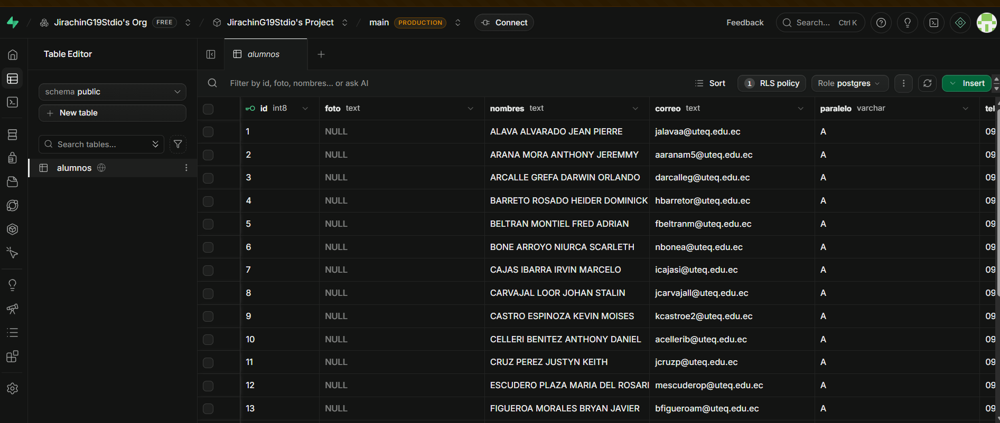
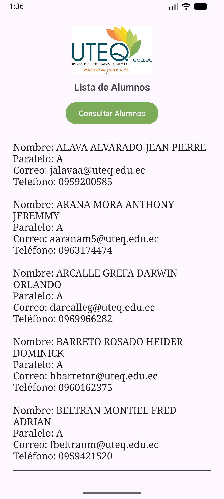

# AppMov-Supabasepractice
# Práctica: Consumo de una API RESTful de Supabase en Android

**Asignatura:** Aplicaciones Móviles  
**Docente:** Ing. Cristian Gabriel Zambrano Vega  
**Estudiante:** Fred Adrián Beltrán Montiel  
**Curso:** 6to Software "A" – Universidad Técnica Estatal de Quevedo (UTEQ)

## Descripción
Aplicación móvil nativa Android que consulta la tabla `alumnos` de una base de datos PostgreSQL alojada en **Supabase** a través de su API RESTful (PostgREST), procesa la respuesta JSON y muestra los registros en pantalla.

Funcionamiento:
1. Al abrir la app, o al tocar el botón **Consultar Alumnos**, se envía una solicitud GET a la tabla `alumnos`, ordenada por `nombres` de forma ascendente.
2. Mientras llega la respuesta se muestra un `ProgressBar`.
3. El arreglo JSON recibido se convierte en una lista de objetos `Alumno` mediante `kotlinx.serialization`.
4. Cada alumno se muestra con su nombre, paralelo, correo y teléfono. Si el correo o el teléfono están vacíos, aparece «Sin registrar».

Manejo de errores:
- **Sin registros:** se muestra el mensaje «No se encontraron alumnos.».
- **Errores de conexión o de la API:** se capturan y se muestran en un cuadro de diálogo «Error de conexión» (`SupabaseErrorHandler`).

## Tabla `alumnos` en Supabase

| Columna      | Tipo        | Descripción                     |
|--------------|-------------|---------------------------------|
| `id`         | int8 (PK)   | Identificador del alumno        |
| `nombres`    | text        | Nombres y apellidos             |
| `paralelo`   | text        | Paralelo del curso              |
| `correo`     | text        | Correo electrónico (opcional)   |
| `telefono`   | text        | Teléfono (opcional)             |
| `foto`       | text        | URL de la foto (opcional)       |
| `created_at` | timestamptz | Fecha de registro               |

El acceso de lectura se controla con una política **RLS** (Row Level Security) que solo permite consultar (`SELECT`) la tabla.

## Estructura del proyecto
```
app/src/main/
├── java/com/uteq/software/appsupabasesoftw2026/
│   ├── MainActivity.kt              # Consulta la API y muestra los alumnos
│   ├── data/
│   │   └── SupabaseManager.kt       # Cliente de Supabase con el módulo Postgrest
│   ├── models/
│   │   └── Alumno.kt                # Modelo @Serializable de la tabla alumnos
│   └── utils/
│       └── SupabaseErrorHandler.kt  # Diálogo de errores de conexión
├── res/layout/
│   └── activity_main.xml            # Logo UTEQ, título, botón, ProgressBar y lista
└── AndroidManifest.xml              # Permiso de INTERNET
```

## Capturas

### Tabla `alumnos` en Supabase


### Aplicación mostrando los alumnos


## Tecnologías utilizadas
- Android Studio · Kotlin
- Supabase (PostgreSQL + API RESTful)
- supabase-kt 3.6.0 (`postgrest-kt`) con cliente HTTP Ktor (`ktor-client-android`)
- Kotlin Coroutines (`lifecycleScope`) para la consulta asíncrona
- kotlinx.serialization para convertir el JSON en objetos `Alumno`
- SDK mínimo 34 (Android 14) · SDK objetivo 37

## Configuración de credenciales
Las credenciales de Supabase **no están en el repositorio**. Se leen desde `local.properties`, que está excluido en `.gitignore`, y se inyectan en `BuildConfig` al compilar.

Para ejecutar el proyecto, agrega al archivo `local.properties` de la raíz:
```properties
SUPABASE_URL=https://TU-PROYECTO.supabase.co
SUPABASE_KEY=TU_CLAVE_PUBLICABLE
```
Usa solo la clave publicable (anon/publishable), nunca la `service_role`. Lo que esa clave puede leer lo limitan las políticas RLS de la tabla.

## Cómo ejecutar
1. Clonar el repositorio:
   ```bash
   git clone https://github.com/JirachinG19Stdio/AppMov-Supabasepractice.git
   ```
2. Abrirlo en Android Studio y agregar las credenciales en `local.properties`.
3. Sincronizar Gradle y ejecutar en un emulador o dispositivo con Android 14 o superior.

## Estado
✅ Práctica completada.
